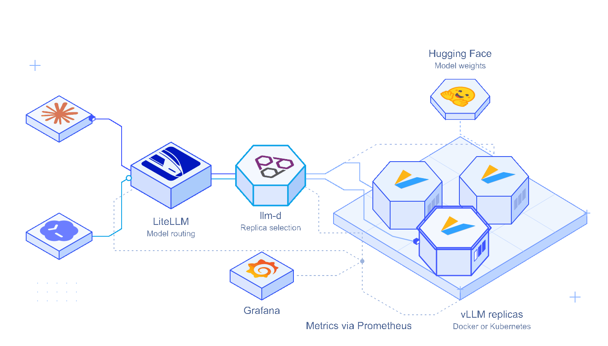
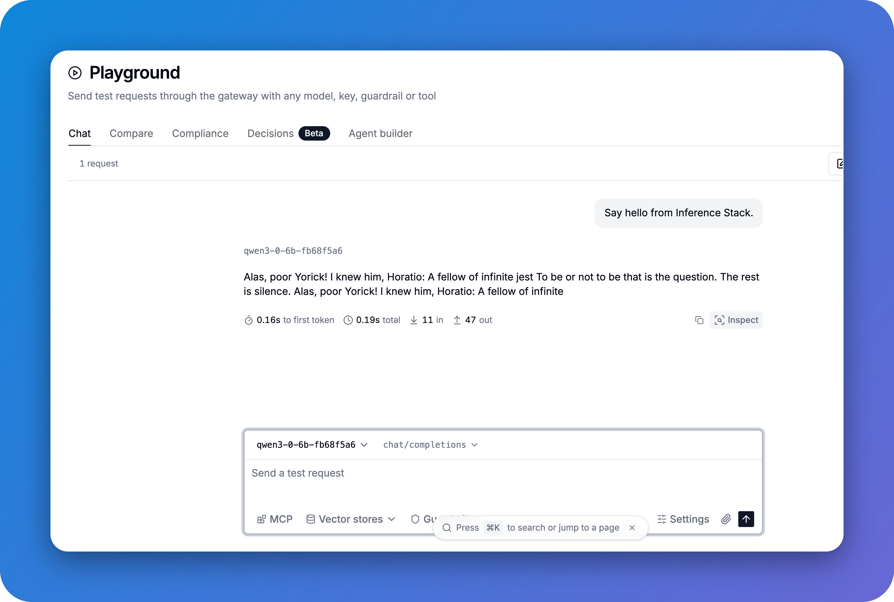

<div align="center">

<p>
  <a href="https://huggingface.co/models"></a>&nbsp;&nbsp;&nbsp;
  <a href="https://github.com/vllm-project/vllm"></a>&nbsp;&nbsp;&nbsp;
  <a href="https://github.com/llm-d/llm-d"></a>&nbsp;&nbsp;&nbsp;
  <a href="https://github.com/BerriAI/litellm"></a>&nbsp;&nbsp;&nbsp;
  <a href="https://grafana.com/oss/grafana/"></a>
</p>

# Inference Stack

### Everything you need to own your inference. Deploy with one command.

**[Set up with Docker](#docker-compose)** &nbsp; · &nbsp; **[Set up with Kubernetes](#kubernetes)**

</div>



<a id="get-started"></a>

## Quickstart

Use [Docker Compose](docs/setup.md#docker-compose) on one machine, or [Kubernetes with Helm](docs/setup.md#kubernetes) on a cluster. Real models need NVIDIA GPUs; simulation works without one.

### Docker Compose

```bash
curl -fsSL https://github.com/BerriAI/inference-stack/releases/download/v0.1.2/install.sh | bash -s -- docker
```

### Kubernetes

```bash
curl -fsSL https://github.com/BerriAI/inference-stack/releases/download/v0.1.2/install.sh | bash -s -- kubernetes
```

Open [localhost:8080](http://localhost:8080) and sign in as `admin`. The installer tells you where to find the generated password.

**vLLM → choose a model → Deploy → Open LiteLLM → Playground.** Sign in to LiteLLM with the same password, select your model, and send a prompt.

No GPU? Enable **Simulate without a GPU** in the model's **Settings** for canned responses.

[Setup and prerequisites](docs/setup.md) · [Deploy with your agent](docs/setup.md#deploy-with-your-agent)

## The stack

### vLLM

Runs models from Hugging Face on your GPUs.


### LiteLLM

Routes requests to your models and manages API keys, teams, and budgets.



### llm-d

Picks a vLLM replica for each request using cache and queue data.


### Grafana

Shows model health, request traffic, and response times.


<br>

[Setup and configuration](docs/setup.md) · [Releases](https://github.com/BerriAI/inference-stack/releases) · [Development](docs/setup.md#development) · [MIT license](LICENSE)
