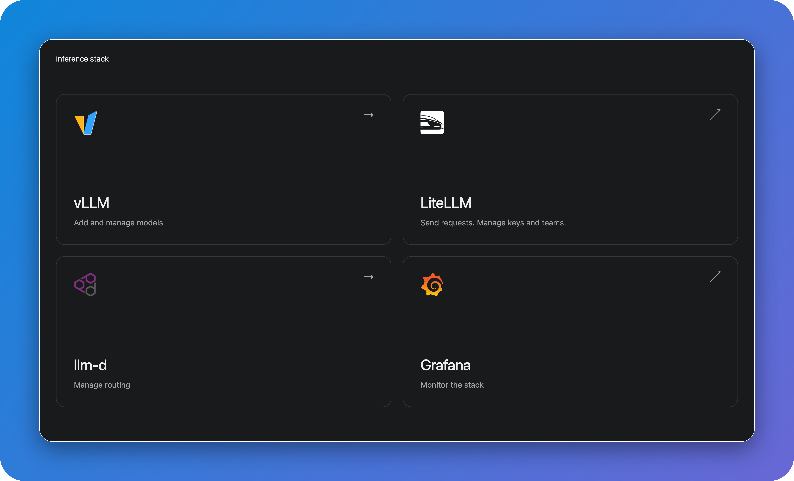
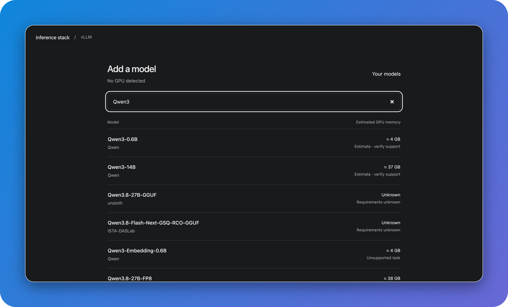
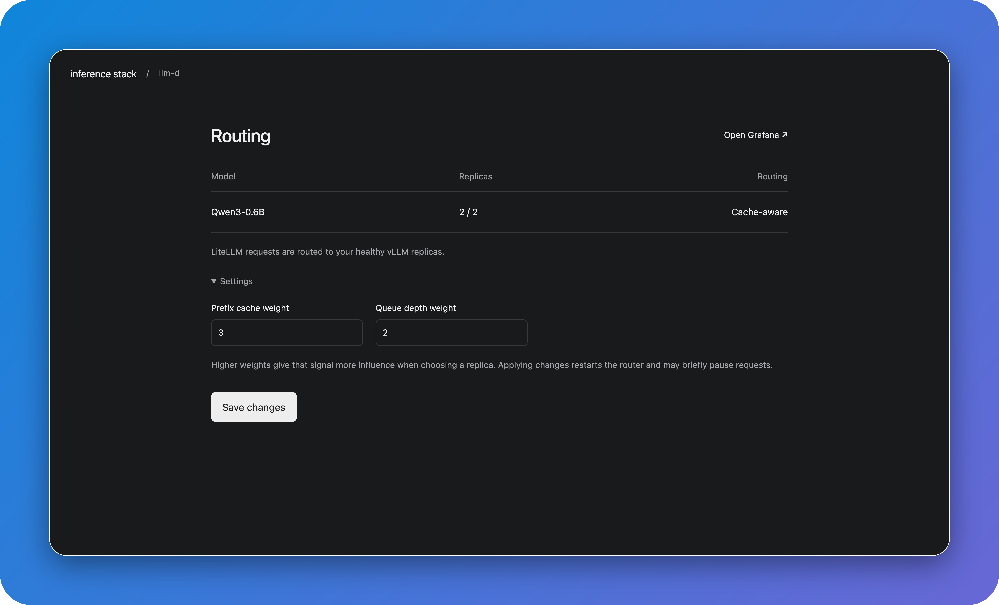
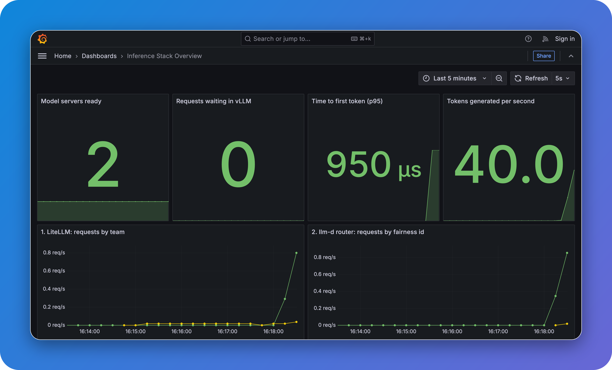

<div align="center">

# Inference Stack

### Everything you need to own your inference. Deploy with one command.

<p>
  <a href="https://huggingface.co/models"></a>&nbsp;&nbsp;&nbsp;
  <a href="https://github.com/vllm-project/vllm"></a>&nbsp;&nbsp;&nbsp;
  <a href="https://github.com/llm-d/llm-d"></a>&nbsp;&nbsp;&nbsp;
  <a href="https://github.com/BerriAI/litellm"></a>&nbsp;&nbsp;&nbsp;
  <a href="https://grafana.com/oss/grafana/"></a>
</p>

**[Set up with Docker](#docker-compose)** &nbsp; · &nbsp; **[Set up with Kubernetes](#kubernetes)**

<br>



</div>

## From model to first request

### vLLM

Find a model on Hugging Face, check its GPU requirements, and deploy it on your hardware.



### LiteLLM

Send requests through one OpenAI-compatible endpoint, with keys, teams, and budgets in one place.


### llm-d

Route requests across healthy replicas using cache and queue signals, with defaults ready to use.



### Grafana

See model health, request traffic, and serving performance across the stack.



## Start using it

The installer downloads a versioned release, verifies the bundle, and generates credentials. Open **vLLM**, choose a model, then **Open LiteLLM** to send your first request.

### Docker Compose

For one machine, with Docker Compose and OpenSSL installed. Real models need an NVIDIA GPU and the [NVIDIA Container Toolkit](https://docs.nvidia.com/datacenter/cloud-native/container-toolkit/latest/install-guide.html).

```bash
curl -fsSL https://github.com/BerriAI/inference-stack/releases/download/v0.1.0/install.sh | bash -s -- docker
```

### Kubernetes

For your current cluster, with Helm, kubectl, OpenSSL, and permission to install resources. Real models need [GPU nodes](https://docs.nvidia.com/datacenter/cloud-native/gpu-operator/latest/getting-started.html).

```bash
curl -fsSL https://github.com/BerriAI/inference-stack/releases/download/v0.1.0/install.sh | bash -s -- kubernetes
```

Open **[localhost:8080](http://localhost:8080)**. The installer tells you where to find your admin password. No GPU yet? Enable **Simulate without a GPU** in the model's **Settings** to try the flow with canned responses.

### Deploy with your agent

Copy the prompt for your environment:

<details>
<summary>Docker Compose</summary>

```text
Set up Inference Stack v0.1.0 on this machine with Docker Compose.
Read https://github.com/BerriAI/inference-stack/blob/v0.1.0/docs/setup.md
and inspect its release installer before running it. Check prerequisites,
preserve any existing installation and credentials, and keep secrets out
of chat and logs. Start the stack, verify its health, and open the launcher.
Help me deploy a model that fits my GPUs and send a request in LiteLLM.
If no GPU is available, offer simulation and identify its canned response.
```

</details>

<details>
<summary>Kubernetes</summary>

```text
Set up Inference Stack v0.1.0 in Kubernetes.
Read https://github.com/BerriAI/inference-stack/blob/v0.1.0/docs/setup.md
and inspect its release installer before running it. Confirm the current
cluster is the intended target, check permissions and GPU capacity, and
preserve existing releases and credentials. Keep secrets out of chat and
logs. Install the stack, verify its pods, and open the launcher through
port-forwarding. Help me deploy a model and send a request in LiteLLM.
Use simulation only if I choose it. Ask before provisioning paid resources.
```

</details>

<br>

[Setup and configuration](docs/setup.md) · [Releases](https://github.com/BerriAI/inference-stack/releases) · [Development](docs/setup.md#development) · [MIT license](LICENSE)
